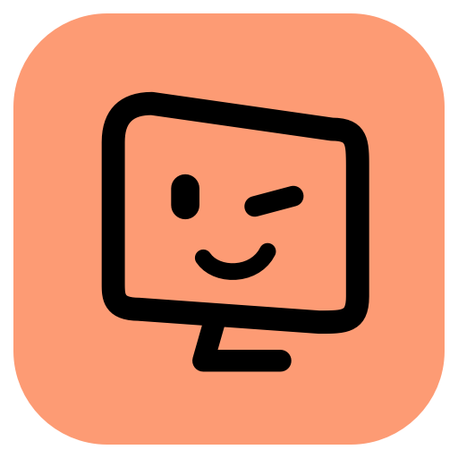
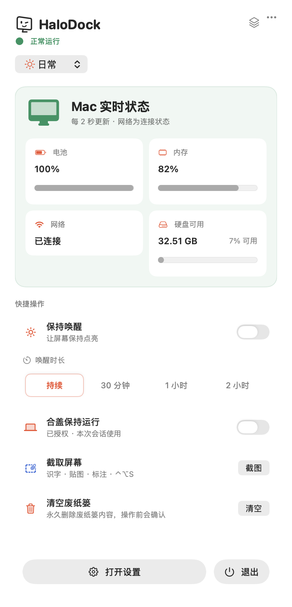
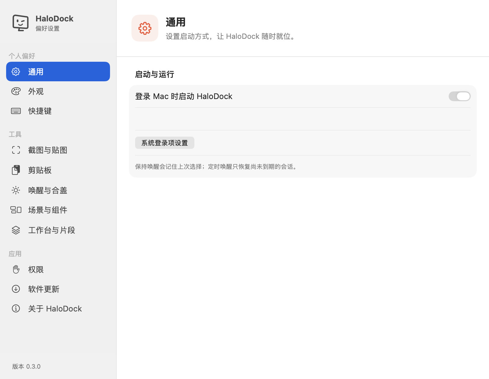
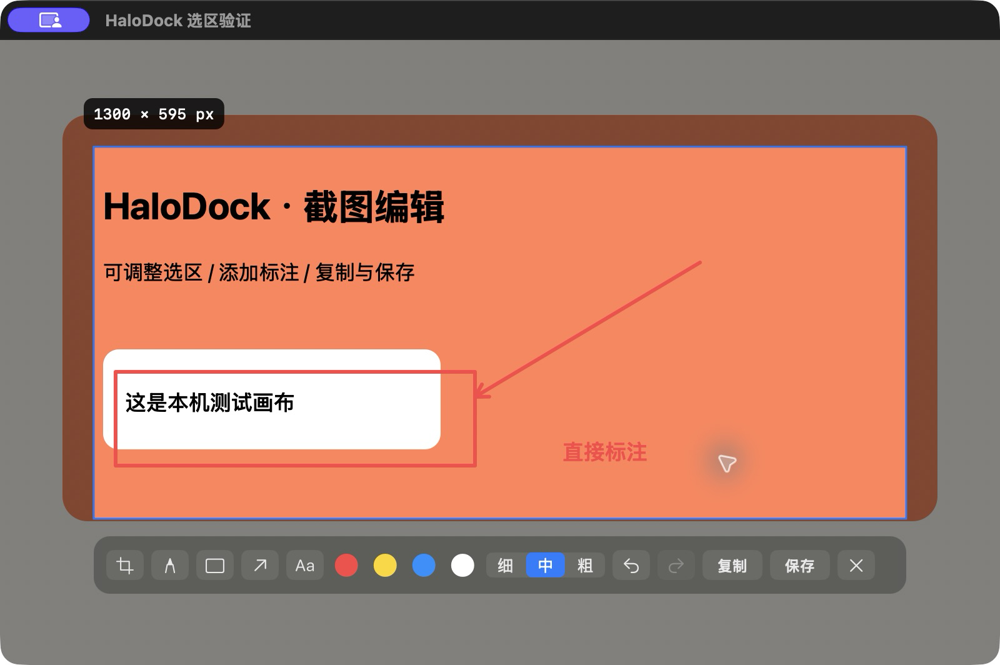
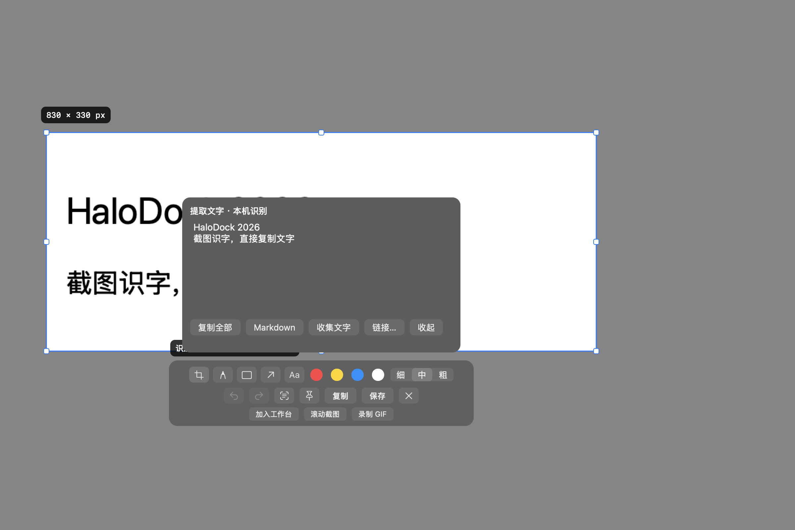
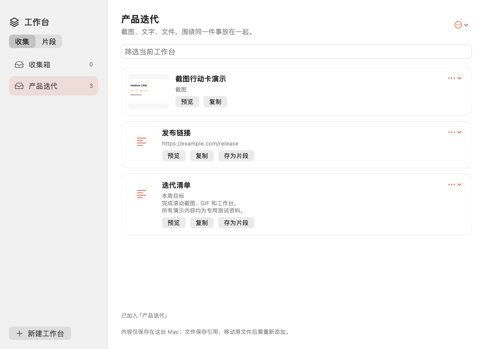
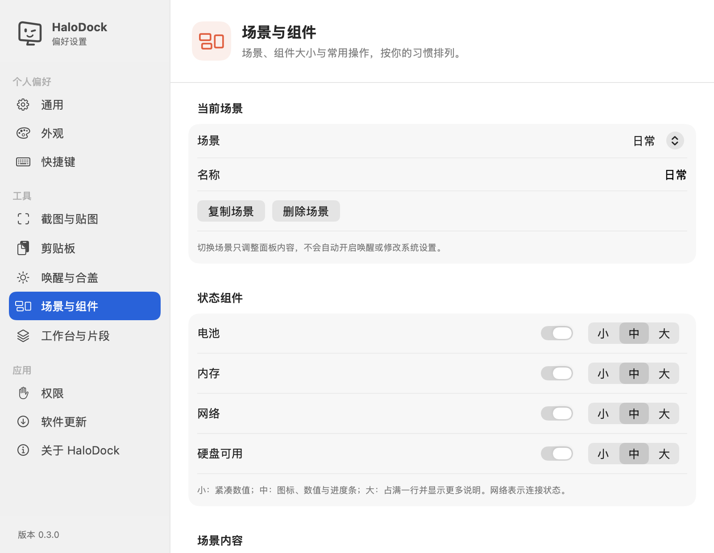
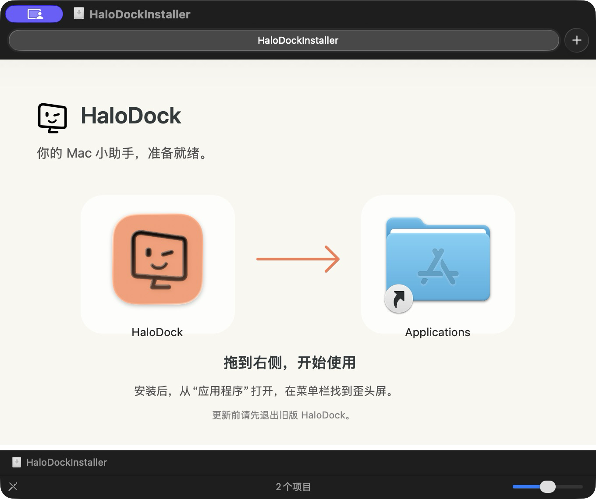

<p align="center">
  
</p>

<h1 align="center">HaloDock</h1>

<p align="center">
  <strong>菜单栏里的轻量工具箱，你的 Mac 小助手。</strong><br />
  查看系统状态、找回刚复制的内容、完成常用操作，一个入口就够。
</p>

<p align="center">
  macOS 13+ · Apple Silicon · SwiftUI + AppKit · 中文界面
</p>

<p align="center">
  <a href="https://github.com/huangzhuangjia/halodock/releases/latest">下载最新版本</a> ·
  <a href="#界面预览">界面预览</a> ·
  <a href="#安装与更新">安装说明</a> ·
  <a href="https://github.com/huangzhuangjia/halodock/issues">反馈问题</a>
</p>

[访问 HaloDock 官网](https://huangzhuangjia.github.io/halodock/)

## 界面预览

<table>
  <tr>
    <th>菜单栏面板</th>
    <th>偏好设置</th>
  </tr>
  <tr>
    <td align="center"></td>
    <td align="center"></td>
  </tr>
</table>

界面图由 App 视图渲染，状态数值来自本机；剪贴板演示使用专用测试内容，不包含私人内容。设置采用左侧分类导航、右侧内容切换；各分类可独立滚动。

## 截图：选好范围，原地编辑

从 v0.1.5 起，拖动选区时会显示像素宽高；松手后可以拖动选区或拉伸八个控制点，并直接使用选区下方的工具栏标注，不需要确认或跳转编辑页面。



工具栏提供：调整选区、画笔、矩形、箭头、文字、四种颜色、三档粗细、撤销、重做、提取文字、桌面贴图、复制、保存。`1`–`4` 切换标注工具，`⌘Z` 撤销，`⇧⌘Z` 重做，`⌘C` 或回车复制，`⌘S` 保存，`Esc` 取消。文字在选区里输入，回车确认文字。

从 v0.2.0 起，点击 **提取文字**，可在当前截图上查看和修改中英文识别结果、选择复制或复制全部；使用 Apple Vision 在本机识别，无需联网。点击 **图钉**，可将当前截图（含标注）置顶悬浮，拖动标题栏移动、边缘缩放，底部可调显示比例和透明度，支持复制及保存，最多同时 8 张。贴图在关闭窗口或退出 App 后释放。



首次截图需要屏幕录制权限；拒绝时会引导去系统设置。所有截图与标注在本机处理，示例图使用专用测试画布，不包含私人屏幕内容。

## v0.3：从截图到工作台

- **截图行动卡**：选区下方直接加入工作台、滚动截图或录制 GIF；识字结果支持复制 Markdown、收集文字、选择打开识别出的网页链接。网页链接只在点击后打开。
- **工作台**：面板顶部的叠层图标打开独立工作台；按任务新建、重命名和删除收集区，加入文字、截图、GIF 和文件引用，支持拖入、筛选、预览、复制、跨工作台移动和导出 Markdown（图片附件一并导出）。
- **快捷文本片段**：在工作台的“片段”页创建、编辑、分组和复制；支持 `{{日期}}`、`{{时间}}`、`{{剪贴板}}` 变量，在点击复制时展开。最近复制菜单和工作台文字项都可存为片段。
- **场景面板**：日常、工作、会议、下载四套预设，可复制、重命名，最多 12 套。每套独立选择状态组件、快捷操作顺序、剪贴板和工作台显示；切换只调整面板，不自动修改系统设置。
- **组件尺寸**：设置 → 场景与组件中选择小、中、大；中、大尺寸提供内存已用和硬盘可用比例进度条，大尺寸独占一行。网络只显示连接状态。



### 滚动截图

1. 普通截图选中需要拼接的内容区域，避开固定标题栏和悬浮元素。
2. 在选区下方点击“滚动截图”。
3. 回到原窗口向下滚动约半屏，保留至少约 1/3 重叠，再点击“添加下一屏”。
4. 自动识别重叠并拼接，控制条显示当前预览、屏数和像素尺寸；完成后可复制长图、保存 PNG 或加入工作台。

最多 20 屏、24000 像素高或 4000 万像素；宽度超过 1600 像素时等比缩小。动态、空白或无法匹配的画面会提示重试，不自动错误拼接；“直接追加”经确认后不做去重。这是手动滚动、自动去重拼接，不会自动控制其他应用滚动。

### 选区 GIF

选区下方点击“录制 GIF”，在控制条开始后有 3 秒倒计时；最长 15 秒、最多 120 帧，长边最多 900 像素，不录制声音。帧率取决于系统采集速度；可提前停止并导出 GIF 或加入工作台，关闭控制条会取消并清理临时文件。macOS 14+ 会从采集中排除 HaloDock 录制控制条，macOS 13 在采集时短暂隐藏控制条。

工作台文件保存在本机 `~/Library/Application Support/HaloDock/Workbench/`。最多 30 个收集区、300 项，附件总量 300 MB、单项 40 MB；文本片段最多 200 条，单条最多 100 KB。文件以原位置引用，不会自动复制原文件；原文件移动后需重新添加。工作台与片段会跨重启保留，普通剪贴板清理规则不影响它们。

## 可以做什么

| 功能 | 使用方式 |
| --- | --- |
| 实时状态 | 电池、内存占用、网络连接、硬盘可用空间，每 2 秒刷新；内存和硬盘比例进度条 |
| 保持唤醒 | 持续唤醒，或 30 分钟／1 小时／2 小时倒计时；菜单栏显示剩余时间，到期自动关闭，未到期会话重启后继续 |
| 合盖保持运行 | v0.1.7 起，首次管理员授权后可合盖运行；支持定时会话、关闭与异常恢复 |
| 截取屏幕 | 原地标注、识字、Markdown、链接行动卡、贴图、工作台收集、滚动拼接、选区 GIF |
| 清空废纸篓 | 确认后交由 Finder 清空；缺少权限时引导至系统设置 |
| 专注模式 | 快速打开系统专注模式设置 |
| 最近复制 | 文字、图片、多文件记录；固定常用内容、删除及清空未固定记录；可设置自动清理时间 |
| 自定义快捷键 | 打开面板、截屏、切换唤醒，全局生效；支持录制、停用和冲突提示 |
| 面板自定义 | 场景切换，状态组件小／中／大，独立操作开关与顺序，全局模块显隐 |
| 开机启动 | 默认开启，安装到“应用程序”后首次启动注册系统登录项 |
| 外观设置 | 跟随系统、浅色、深色；提供珊瑚橙、蓝色、绿色强调色 |



“歪头屏”是 HaloDock 的品牌形象，菜单栏、面板和设置页使用同一份矢量图形。

## 安装与更新

1. 前往 [GitHub Releases](https://github.com/huangzhuangjia/halodock/releases/latest)，下载 `HaloDock-<版本>-macos-arm64.dmg`。
2. 打开安装包，将 **HaloDock.app** 拖到右侧 **Applications**。
3. 从“应用程序”打开 HaloDock，点击菜单栏里的“歪头屏”图标。
4. 已安装 v0.1.6 及以上版本，可在“设置 → 软件更新”直接完成下载、安装与重启；也可退出后手动替换。

当前发布包适用于 **Apple Silicon Mac，macOS 13 及以上**。仓库公开，源码和安装包均可直接访问。



当前版本使用 **ad-hoc 签名，尚未进行 Apple Developer ID 签名与公证**。每次构建的代码身份会变化，更新后 macOS 可能再次请求屏幕录制、自动化等隐私权限；安装记录不等于系统权限会自动继承。合盖模式的窄范围管理员授权保存在系统规则中，正常更新会保留，开启会话的确认提示也不等于重新授权。如果 macOS 阻止打开，请查看“系统设置 → 隐私与安全性”中的对应提示。

每版安装包附带 `.sha256` 文件。将 DMG 和校验文件放到同一目录后，可以检查下载完整性：

```sh
shasum -a 256 -c HaloDock-0.2.0-macos-arm64.dmg.sha256
```

## 合盖保持运行

从 v0.1.7 起，可在面板或设置中开启“合盖保持运行”。第一次会请求管理员授权，为当前用户安装**仅允许两条电源命令**的规则；不会授权任意 shell 命令，也不会修改 Vorssaint 或其他工具的配置。授权规则为 `/etc/sudoers.d/halodock-clamshell`，可在设置中撤销。

- 可选 30 分钟、1 小时、2 小时，或直到手动关闭；默认 1 小时。
- 只开启本次会话，不会在重启后自动再次开启。
- 正常关闭或退出 App 时恢复开启前的睡眠设置；独立保护进程会在 App 异常退出后尝试恢复。
- 电池供电时电量不高于 20%，或系统报告严重／临界热状态时会恢复睡眠。
- 合盖模式开启时状态栏显示珊瑚橙；自动更新会先等待关闭合盖模式。
- 若突然断电、保护进程被强制结束，或授权规则被外部移除，可能需要下次打开 HaloDock 后恢复；恢复失败时界面提供“授权恢复睡眠”。

这项系统级设置也会影响手动睡眠。合盖运行时保持通风；不要和其他合盖工具同时控制同一个全局设置。如果系统原先已被其他工具设置为不睡眠，结束 HaloDock 会话会保留该原设置。

卸载前请先关闭合盖会话，并在设置中点击“撤销合盖授权”，再移除应用。

## 权限与数据

**清空废纸篓**需要允许 HaloDock 控制 Finder。首次确认清空时，系统会请求自动化授权；若已拒绝，可从 App 设置中的权限入口前往 **隐私与安全性 → 自动化 → HaloDock → Finder**。清空属于永久删除，操作前会再次确认。

**开机启动**使用 macOS 系统登录项。在“应用程序”中首次启动后注册；若系统要求批准，设置页提供登录项入口。开发目录运行时只保存偏好，不注册临时构建路径。

**剪贴板历史**在本机处理，不上传服务器：

- 最多保留 50 条，总大小最多 32 MB。默认面板显示 3 条，可展开全部；重复内容移至最前。
- 支持文本、图片和多个文件引用；文本最多 100 KB，图片单张最多 8 MB、2500 万像素，多文件最多记录 100 个引用。
- 普通记录仅保存在内存，退出后清空；可选择 15 分钟、1 小时（默认）、24 小时自动清理，或仅退出时清理。
- 主动固定的最多 10 条会保存在本机偏好中，总大小最多 16 MB，不受自动清理影响；取消固定或删除会移除对应的持久记录。
- 跳过带保密、临时或自动生成标记的内容；未带这些标记的敏感文本仍可能被记录。
- 只记录 HaloDock 启动后的新复制，不读取之前的历史。

**全局快捷键**默认：`⌃⌥Space` 打开面板、`⌃⌥S` 截图、`⌃⌥A` 切换唤醒。可在设置中点击录制新的组合，`Esc` 取消，点击 × 停用；组合被占用时保留原设置并提示。使用系统热键注册，不需要辅助功能权限；截图编辑期间不触发其他全局操作。

**系统指标**来自本机。网络只表示系统路径连接状态，不代表互联网速度或可达性；内存占用由虚拟内存统计估算，不代表内存压力。读取失败会显示不可用。

## 检查更新

从 v0.1.4 起，可在“设置 → 软件更新”中手动检查，也可以开启自动检查（默认开启，启动后及每 6 小时检查）。发现新版本时显示更新说明和更新入口，按当前 Mac 架构选择安装包。v0.1.4–v0.1.5 下载后打开 DMG 手动安装；从 v0.1.6 起，在 App 内显示下载、校验与准备进度，自动替换并短暂重启，不再要求手动打开 DMG。

更新来源是 GitHub 正式 Releases，忽略草稿和预发布版本。公共 API 限流或不可达时回退到官网的 `release.json`；版本清单由 GitHub Actions 从 Releases 生成，不包含访问 Token。下载会核对附件大小，存在 GitHub SHA-256 摘要时也会校验摘要。失败不会被显示成“已是最新版”。

App 内安装使用内置更新器：先在应用同目录准备并校验新版，等旧进程退出后备份旧版、替换并启动新版；安装或启动失败时尝试恢复旧版。若截图正在编辑，准备好后暂缓重启。应用目录需要当前用户可写；从只读 DMG 运行或没有写入权限时会提示，保留原应用。v0.1.5 及更早版本需要手动安装一次 v0.1.6，之后才具备 App 内替换能力。

官网源码在 `website/`，由 `.github/workflows/pages.yml` 部署到 GitHub Pages。官网修改和正式 Release 发布都会触发部署，刷新公开版本清单。

## 本地开发

需要 Xcode 或对应的 Swift 工具链。

```sh
git clone https://github.com/huangzhuangjia/halodock.git
cd halodock
swift build
./Scripts/build-app.sh
open .build/HaloDock.app
```

生成 DMG：

```sh
DMG_PYTHON=python3.12 ./Scripts/build-dmg.sh
```

首次打包需要 Python 3.10+。脚本在 `.build/dmg-tools/` 中安装独立的 dmgbuild 1.6.7，不修改系统 Python。产物输出到 `dist/`，安装包作为 GitHub Release 附件管理，不提交到 Git。

| 目录 | 内容 |
| --- | --- |
| `Sources/HaloDock/` | 状态栏、SwiftUI 界面与本机能力 |
| `Resources/` | 应用元数据 |
| `Scripts/` | App、图标、DMG 与文档截图生成脚本 |
| `docs/images/` | README 品牌图与界面演示 |
| `Design/` | 图标方案与设计探索 |
| `website/` | GitHub Pages 官网与公开版本清单 |

遇到问题，可以在 [Issues](https://github.com/huangzhuangjia/halodock/issues) 中描述 macOS 版本、HaloDock 版本和复现步骤；截图前请隐藏私人内容。
